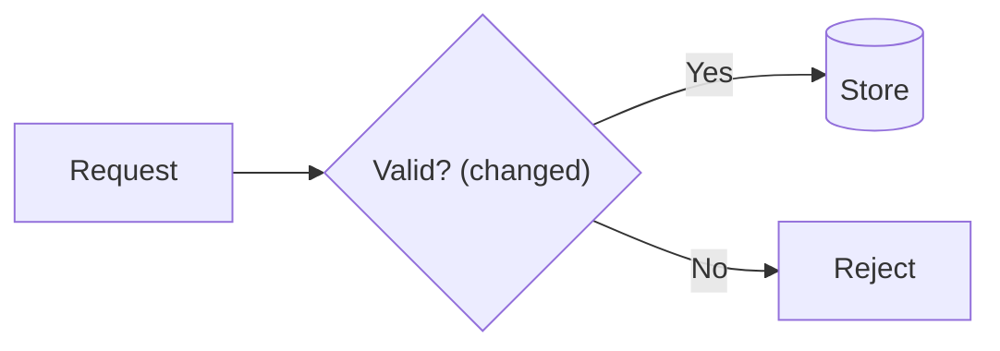

# PR Writing Reference

Read when composing a PR title, body, template-based publication, or
incremental update comment.

Write for a human reviewer deciding how much attention this PR deserves. Some
reviews matter more than others: lead with what changed and why, show the
shape of the change when a picture helps, and end with an honest account of
what could go wrong after merge and how hard it would be to undo.

## Title

Write a short outcome-focused title. Prefer verbs and user-visible effects over
implementation mechanics. Avoid vague titles such as `updates`, `misc fixes`,
or `work on feature`.

## Body

Use the repository template when available (see Templates and plans). When no
useful template exists:

````markdown
## Summary
One to three plain-language sentences: what changes, why, and who notices.

**Review weight:** Low | Medium | High - one-line reason

## Visual evidence
At least one useful visual, its takeaway, and the evidence commit. Add more
when each answers a different review question.
For an exempt change: one sentence explaining why a visual adds no value.

## Changes
- ...
- ...

## Testing
- `command` - passed

## Notes
- ...

## Merge danger
- **Door:** Two-way | One-way - why
- **Revert:** what undoing this takes
- **Blast radius:** who or what is affected if this is wrong
- **Watch after merge:** the signal that would show a problem
````

Section rules:

- **Summary** is for a reviewer who reads nothing else. Avoid file names and
  jargon there; save mechanics for `Changes`.
- **Review weight** tells the reviewer how carefully to look. Derive it from
  the merge danger assessment: a one-way door or a wide blast radius is at
  least Medium; a one-way door with a wide blast radius is High.
- **Visual evidence** contains the simplest useful visual under the rules
  below, or a brief exemption. Replace the example instructions with evidence.
- **Changes** groups the diff by behavior or area, not by commit. Call out the
  files that most deserve review attention.
- **Testing** appears only when tests were run or a passing result was directly
  observed.
- **Notes** holds follow-ups, migrations, screenshots that still need human
  review, or plan/diff mismatches. Omit it when empty.
- **Merge danger** is always the last section, even when every line is
  low risk. Short is fine; missing is not.

Never claim approvals, screenshots, deployments, passing CI, or test results
that were not observed.

## Visual evidence

Include at least one useful visual in every PR. Actively look for a visual
that explains the change or demonstrates its result. Add further visuals when
each helps answer a different review question, such as how the flow changed,
what it looks like before and after, or how performance compares. Choose the
formats that fit; there is no fixed maximum. Prefer image attachments for
before/after screenshots, comparison plots, and custom visualizations; use
native Mermaid when a small diagram is clearer. If no useful visual can be
produced, briefly explain why in the Visual evidence section.
Choose by what the reviewer needs to understand:

- **Behavior or architecture:** Mermaid flow, sequence, or state diagram.
- **UI or rendered output:** labeled before/after images captured with the same
  viewport, input, and relevant state; annotate the changed area.
- **Performance or data:** a comparison plot from observed measurements. Name
  the baseline, units, sample size, and measurement conditions. Use comparable
  scales and show variability when measured; never invent benchmark values.
- **Other changes:** customize the visual to the question, such as a dependency
  graph, heatmap, waveform, spectrogram, or annotated terminal capture. Export
  custom charts and HTML views to PNG or SVG for inline review.

Give each visual a short takeaway and descriptive alt text. Record the commit
represented by captured or measured evidence; identify the baseline for
comparisons. Separate measured results from explanatory illustrations. Inspect
the rendered image for readable labels, cropping, and light/dark contrast.
Refresh affected visuals when later commits change what they show.

For interactive HTML or JavaScript charts, attach a static preview and link to
an accessible report when one exists. PR Markdown does not run arbitrary HTML
apps or iframe embeds. Do not create public hosting just to satisfy this rule.

### Mermaid diagrams

GitHub renders fenced `mermaid` blocks in PR bodies. Use a diagram when it
shows something faster than prose:

- `flowchart` for how components, modules, or services connect after the
  change, or a before/after of a restructured path.
- `sequenceDiagram` for request, auth, webhook, event, or other time-ordered
  flows that the change touches.
- `stateDiagram-v2` for changed status or lifecycle transitions.

Keep diagrams to about 12 nodes, draw only what the diff shows, and highlight
the changed part with a `classDef changed` style or a `(new)` / `(changed)`
label. For example, when validation moves ahead of a write:



Quote labels that
contain punctuation (`A["parse(input)"]`). Preview the actual GitHub rendering;
new syntax may not be supported by GitHub's deployed Mermaid version.

### Attach and verify images

Check each file's byte size before upload. GitHub's documented limits are
10 MB per image or GIF, 10 MB per video for free repository-owner plans,
100 MB per video for paid plans subject to uploader eligibility, and 25 MB for
other attachments. Keep files below the applicable limit; use the 10 MB video
limit unless the higher allowance is verified. Crop, resize, compress, or split
oversized visuals while preserving readable labels. Prefer PNG for screenshots,
SVG for static vector plots, and JPEG for photographic content. Use video or
GIF only when motion helps explain the change; prefer H.264 MP4 for video.
See [GitHub's attachment limits](https://docs.github.com/en/get-started/writing-on-github/working-with-advanced-formatting/attaching-files)
if an upload is rejected or plan eligibility is unclear.

Check the installed command's help for `--attach` before relying on it. Where
supported, write local image paths into the body file and pass the same paths
with repeated `--attach` flags; the CLI rewrites them to uploaded URLs:

```markdown


```

```text
gh pr create --repo OWNER/REPO --base BASE --head HEAD --body-file pr-body.md --attach before.png --attach after.png
```

Use the corresponding `gh pr edit` or `gh pr comment` command for updates.
Uploads require repository push access. If the flag is unavailable, use browser
uploads or existing image URLs accessible to reviewers; do not leave local
filesystem paths in a published body. Do not add generated images to Git solely
to work around an unavailable uploader. See
[CLI attachment behavior](https://docs.github.com/en/github-cli/github-cli/attaching-files-with-github-cli).

After posting, verify that the images load and any report links work for the
intended reviewers. Do not use expiring Actions artifact download URLs as
inline image sources. If uploading or rendering is blocked, retain the local
assets and report the blocker and unverified visuals in the handoff; do not
claim they were published or replace missing evidence with fabricated output.

## Incremental updates

For an already open PR, an update comment should describe only the incremental
change since the last pushed commit visible on the PR:

```markdown
## Update summary
- ...
- ...

## Testing
- `command` - passed

## Merge danger
- Unchanged.
```

Write `Unchanged.` under Merge danger when the update does not move the
assessment. Otherwise restate only the lines that changed, and update the PR
body so its Merge danger section stays current.
Refresh the body's affected visual evidence and include a new image or diagram
in the update only when it helps explain the incremental change.

## Review summary comment

After a corrective push, post one comment covering every finding from the
delegated and automated reviews and every check repair. It replaces the
incremental update comment for that push. Post nothing when no corrective push
is made:

```markdown
## Review summary
Reviewed `<base-sha>..<head-sha>` with <reviewer(s)>.

| Finding | Verdict | Reason |
|---|---|---|
| RC-001 Short title | Fixed in `<sha>` | ... |
| RC-002 Short title | Rejected | ... |
| <bot> [thread](<url>) Short title | Needs user decision | ... |

## Check repairs
- `<check>` failed because ...; fixed in `<sha>`.

## Testing
- `command` - passed

## Merge danger
- Unchanged.
```

Use the reviewer's finding ID, or the bot name and thread link when there is
none. Write `No findings.` in place of an empty table, and omit
`Check repairs` when there were none. State reasons in terms of the code and
project direction; do not quote private conversation or scratch artifacts.

## Templates and plans

Preserve applicable template headings and leave checklist items unchecked unless
directly verified. Remove placeholder instructions when replacing them with
real content; do not invent issue links, screenshots, reviewers, approvals, or
deployment notes. Unless the template already has an equivalent, add the
Review weight line near the top, a Visual evidence section following the rules
above, and `## Merge danger` as the last section. If `plan.md` exists, use it
as intent context, not proof; the observed diff and command output win when
they conflict.
